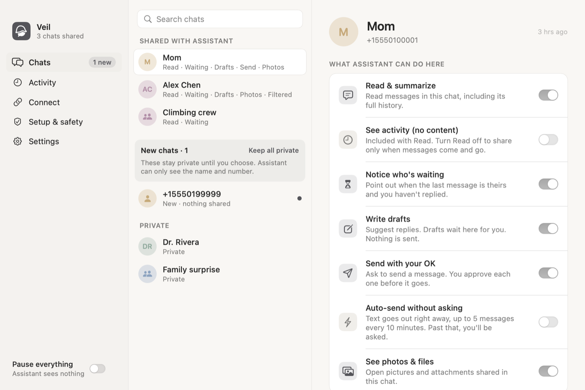
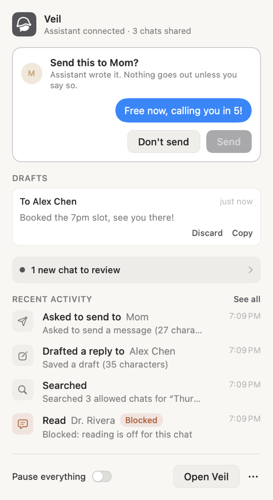

# Veil

Let your AI assistant into your Messages, one chat at a time.

Veil is a small Mac menu bar app that sits between Apple Messages and any assistant that speaks
[MCP](https://modelcontextprotocol.io) (Claude Desktop, Cursor, your own agent). You pick which
chats it can read, draft in or send to. Everything else stays private, and nothing is sent without
your click.

<p align="center">
  
</p>
<p align="center">
  
  &nbsp;
  
</p>

## How it protects you

- **Everything starts off.** Every chat, including new ones, stays locked until you open it up.
- **One switch at a time.** Per chat: read, see activity only (when, not what), draft, send with your OK, photos. Hidden chats don't exist as far as the assistant can tell.
- **You approve every send**, unless you turn on rate-limited auto-send for a specific chat.
- **The assistant can't change any of this.** No tool exists for it, and the settings file is signed.
- **On your Mac only.** Veil reads Messages read-only, can filter cards, codes, passwords and sensitive topics on-device (including in photos), and logs every request.
- **Fails closed.** Anything Veil can't check is withheld.

```
 assistant ──stdio──▶ veil-mcp ──socket──▶ Veil.app ──read-only──▶ Messages (chat.db)
 (no disk access)     (relay only)         (your rules, logs, asks you)
```

## Install

Requires macOS 14 or later. The optional on-device filter needs Apple Intelligence (macOS 26+; photo checks need macOS 27).

A signed download is on the way. For now, build it with Xcode 27:

```bash
git clone https://github.com/benlittlle/veil.git && cd veil
scripts/build-app.sh --install
open ~/Applications/Veil.app
```

The app walks you through **Full Disk Access** (required, so Veil can read Messages) and **Contacts**
(optional, for names). macOS asks about controlling Messages the first time you approve a send.
Signing tips are in [CONTRIBUTING.md](CONTRIBUTING.md#getting-set-up).

## Connect your assistant

Make sure the assistant itself has **no** Full Disk Access and its own Messages access is off,
otherwise it can skip the gate. Then add Veil as an MCP server (the app's *Connect* screen has a
copy button):

```json
{
  "mcpServers": {
    "veil": { "command": "/Users/<you>/Applications/Veil.app/Contents/MacOS/veil-mcp" }
  }
}
```

In Claude Code: `claude mcp add veil -- ~/Applications/Veil.app/Contents/MacOS/veil-mcp`.
Assistants that only take a URL can use the local web address under *Connect*.

Open a chat in Veil, flip on what you want to share, and ask something like
"Who's waiting on a reply from me?" Every request shows up under **Activity**.

## Good to know

- Once the assistant has seen a message, Veil can't take it back.
- The content filter lowers risk but can miss things. Only *Read* off is certain.
- Auto-send trusts the assistant; a message it reads could try to trick it. Use it for low-stakes chats.
- Anything on your Mac with Full Disk Access can read Messages directly. Veil only helps if your assistant doesn't have it.

## More

- [Guide](docs/guide.md): every feature, including the content filter, photo checks, auto-send and new-message pings
- [Security model](docs/security-model.md): what's enforced and the limits
- [Contributing](CONTRIBUTING.md) · [Reporting a security issue](SECURITY.md)

MIT licensed. See [LICENSE](LICENSE).
