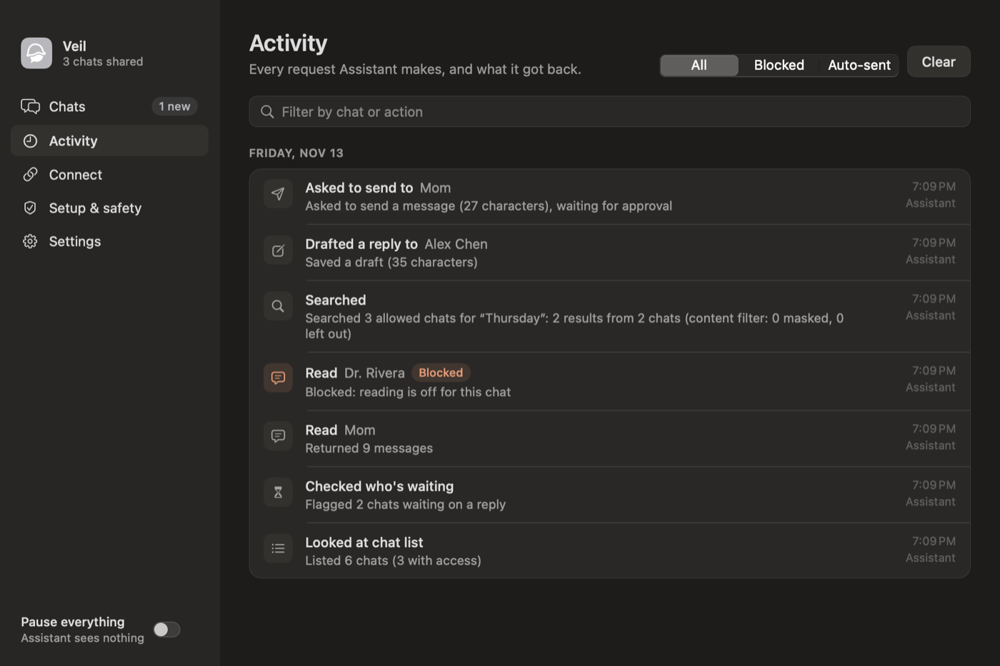

# Veil

Let your AI assistant into your Messages, one chat at a time.

Veil is a small Mac menu bar app that sits between Apple Messages and any assistant that speaks
[MCP](https://modelcontextprotocol.io) (Claude Desktop, Cursor, your own agent). You pick which
chats it can read, draft in or send to. Everything else stays private, and nothing is sent without
your click.

<p align="center">
  
</p>
<p align="center">
  
  &nbsp;
  
</p>

## How it protects you

- **Everything starts off.** Every chat, including new ones, stays locked until you open it up.
- **One switch at a time.** Per chat: read, see activity only (when, not what), draft, send with your OK, photos. Hidden chats don't exist as far as the assistant can tell.
- **Share less, for less time.** Per chat, limit how far back it can read (24 hours, 7 or 30 days, or only since you shared it) and end sharing on its own after an hour, tonight or a week.
- **You approve every send**, unless you turn on rate-limited auto-send for a specific chat.
- **The assistant can't change any of this,** unless you choose *Ask me* (you approve each change) or *Apply directly* in Settings. It's off by default, and the settings file is signed.
- **On your Mac only.** Veil reads Messages read-only, can filter cards, codes, passwords and sensitive topics on-device (including in photos), and logs every request.
- **Fails closed.** Anything Veil can't check is withheld.

```
 assistant ──stdio──▶ veil-mcp ──socket──▶ Veil.app ──read-only──▶ Messages (chat.db)
 (no disk access)     (relay only)         (your rules, logs, asks you)
```

## Install

Requires a Mac with Apple silicon and macOS 14 or later. The optional on-device filter needs Apple Intelligence (macOS 26+; photo checks need macOS 27).

**[Download Veil](https://github.com/benlittlle/veil/releases/latest)** (the `.dmg`), open it and drag
Veil to Applications. It's signed and notarized by Apple, and keeps itself up to date.

Or build it yourself with Xcode 27:

```bash
git clone https://github.com/benlittlle/veil.git && cd veil
scripts/build-app.sh --install
open ~/Applications/Veil.app
```

The app walks you through **Full Disk Access** (required, so Veil can read Messages) and **Contacts**
(optional, for names). macOS asks about controlling Messages the first time you approve a send.
Signing tips are in [CONTRIBUTING.md](CONTRIBUTING.md#getting-set-up).

## Connect your assistant

Turn off the assistant's own Messages integration, if it has one, so it goes through Veil. Then
open Veil's *Connect* screen: one-click buttons add Veil to **Claude Desktop**, **Cursor** and
**Claude Code**, showing exactly what changes and backing up the config file first. For anything
else, copy the config:

```json
{
  "mcpServers": {
    "veil": { "command": "/Applications/Veil.app/Contents/MacOS/veil-mcp" }
  }
}
```

In Claude Code: `claude mcp add --scope user veil -- /Applications/Veil.app/Contents/MacOS/veil-mcp`.
If you built Veil yourself, it's in `~/Applications` instead; the *Connect* screen always shows the right path.
Assistants that only take a URL can use the local web address under *Connect*.

Open a chat in Veil, flip on what you want to share, and ask something like
"Who's waiting on a reply from me?" Every request shows up under **Activity**.

## Good to know

- Once the assistant has seen a message, Veil can't take it back.
- The content filter lowers risk but can miss things. Only *Read* off is certain.
- Auto-send trusts the assistant; a message it reads could try to trick it. Use it for low-stakes chats.
- The same goes for letting it change settings directly: a message could trick it into opening up chats or turning on auto-send. *Ask me* is the safer choice.
- Anything on your Mac with Full Disk Access can read Messages directly, and Veil's limits only apply to what an assistant asks Veil for. Veil checks each assistant when it connects and tells you if the app it runs in has Full Disk Access (you can acknowledge it if that's how you want it), and lists the other apps that have it.

## More

- [Guide](docs/guide.md): every feature, including the content filter, photo checks, auto-send and new-message pings
- [Security model](docs/security-model.md): what's enforced and the limits
- [Contributing](CONTRIBUTING.md) · [Reporting a security issue](SECURITY.md)

MIT licensed. See [LICENSE](LICENSE).
